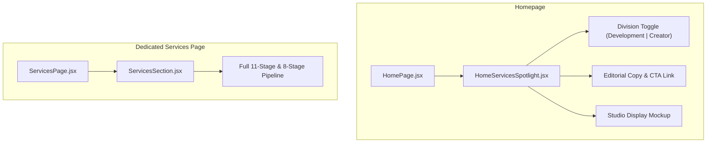

# Homepage Services Spotlight Implementation Plan

> **For agentic workers:** REQUIRED SUB-SKILL: Use superpowers:subagent-driven-development to implement this plan task-by-task. Steps use checkbox (`- [ ]`) syntax for tracking.

**Goal:** Replace the large multi-stage services section on the Homepage with a high-craft two-column editorial spotlight section featuring a left-side division toggle and a right-side studio device preview, on a white background, while preserving the full services section on the `/services` page.

**Architecture:** A lightweight, focused `HomeServicesSpotlight` React component renders an editorial two-column layout. The left column houses the division switcher pill, dynamic headlines, descriptive copy, and a pill CTA button. The right column renders a sleek studio device monitor mockup showcasing digital product UI for Development and dynamic creator canvas for Creator & Content. `HomePage.jsx` mounts this spotlight, while `ServicesPage.jsx` continues to render the full 11-stage/8-stage `ServicesSection`.

**Architecture Diagram:**

**Tech Stack:** React 19, Framer Motion, Manrope typography, Vite, CSS Modules / scoped vanilla CSS.

## Global Constraints
- Strict typography: Exclusively `var(--font-manrope), 'Manrope', sans-serif`. Absolutely no Panchang font mixing.
- Background styling: Pure white (`#ffffff`).
- Scope constraint: Homepage only (`src/pages/HomePage.jsx`). `/services` page (`src/pages/ServicesPage.jsx`) remains unchanged.
- Always address the user as **Hashil**.

---

### Task 1: Build the `HomeServicesSpotlight` Component and CSS

**Files:**
- Create: `src/components/HomeServicesSpotlight.jsx`
- Create: `src/components/HomeServicesSpotlight.css`

**Interfaces:**
- Consumes: `react-router-dom` (`Link`), `framer-motion` (`motion`, `AnimatePresence`).
- Produces: Default export `HomeServicesSpotlight`.

- [ ] **Step 1: Create `HomeServicesSpotlight.jsx`**
  - Implement state `activeDivision` (`'development'` by default).
  - Implement left column with:
    - Pill switcher (`01 / DEVELOPMENT DIVISION (PRIMARY)` vs `02 / CREATOR & CONTENT DIVISION`) with animated Framer Motion indicator.
    - Active division headline and body text with smooth crossfade.
    - Pill CTA button (`See our offerings →`) linking to `/services?division=${activeDivision}`.
  - Implement right column with:
    - Studio monitor frame: realistic bezel, stand shadow, sleek glass/screen sheen, and crisp product/creator mockups.
- [ ] **Step 2: Create `HomeServicesSpotlight.css`**
  - Pure white background (`#ffffff`), clean padding (`clamp(3.5rem, 6vw, 6rem) 0`).
  - Responsive two-column layout (`grid-template-columns: 1fr 1fr` on desktop, `1fr` on tablet/mobile).
  - Strict Manrope font styling for all headings, text, and labels.
  - Pixel-perfect styling for the studio monitor and device frame.
- [ ] **Step 3: Run production build check**
  - Run `npm run build` to verify zero syntax or lint errors.
- [ ] **Step 4: Commit changes**
  - `git add src/components/HomeServicesSpotlight.jsx src/components/HomeServicesSpotlight.css`
  - `git commit -m "feat(ui): create HomeServicesSpotlight component and styles"`

---

### Task 2: Mount `HomeServicesSpotlight` on Homepage and Verify `/services`

**Files:**
- Modify: `src/pages/HomePage.jsx`

- [ ] **Step 1: Update `HomePage.jsx`**
  - Replace import of `ServicesSection` with `HomeServicesSpotlight`.
  - Replace `<ServicesSection />` with `<HomeServicesSpotlight />`.
  - Verify that `ServicesPage.jsx` still imports and mounts `ServicesSection`.
- [ ] **Step 2: Run production build check**
  - Run `npm run build` to ensure clean build.
- [ ] **Step 3: Commit changes**
  - `git add src/pages/HomePage.jsx`
  - `git commit -m "feat(home): replace heavy services section with editorial spotlight on homepage"`

---

### Task 3: Automated Visual Testing & Browser Verification

**Files:**
- Create: `scratch/verify_spotlight.py`

- [ ] **Step 1: Write Playwright verification script**
  - Verify `HomeServicesSpotlight` renders on `http://127.0.0.1:4173/`.
  - Verify toggle switching toggles state, updates headline, and updates CTA link.
  - Capture screenshots of both Development and Creator views.
  - Verify clicking CTA navigates to `/services?division=...` which retains the full `ServicesSection`.
- [ ] **Step 2: Run script and review screenshots**
  - Execute script and inspect captured images.
- [ ] **Step 3: Git push to origin/main**
  - Push commit history to GitHub.
