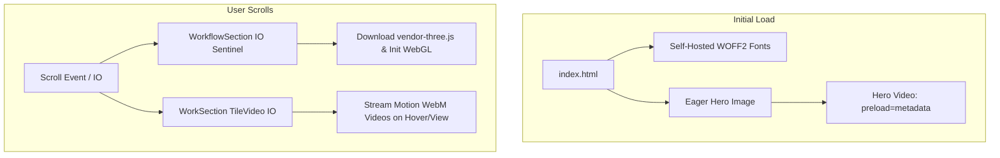

# PageSpeed Insights Performance & Accessibility Optimization Plan

> **For agentic workers:** REQUIRED SUB-SKILL: Use superpowers:subagent-driven-development to implement this plan task-by-task. Steps use checkbox (`- [ ]`) syntax for tracking.

**Goal:** Resolve Google PageSpeed Insights critical bottlenecks on `flostudio.co` by slashing payload size by 10+ MB, eliminating 13s of Total Blocking Time (TBT) from early Three.js execution, unblocking font rendering, and fixing accessibility defects to raise Performance from 43 to 90+ and Accessibility from 93 to 100.

**Architecture:** Defer below-the-fold media and heavy WebGL execution until visible in viewport, replace render-blocking external font requests with self-hosted fonts and asynchronous loading, and correct prohibited ARIA attributes and low-contrast labels.

**Architecture Diagram:**

**Tech Stack:** React 19, Vite, Three.js / React Three Fiber, GSAP, Framer Motion, Node test runner.

## Global Constraints
- Do not remove or degrade any visual features, 3D animations, or styling.
- All existing 57 tests in `tests/*.test.js` must continue passing without regression.
- Work within existing Vite and React patterns without introducing heavy external dependencies.

---

### Task 1: Eliminate Redundant Video Preloading (10.3 MB Network Payload Reduction)

**Files:**
- Modify: `src/components/CasementGrid.jsx:118-135`
- Modify: `src/components/Hero.jsx:43-52`
- Test: `tests/pagespeed-performance.test.js`

**Interfaces:**
- Consumes: `<TileVideo />` and `<Hero />`
- Produces: `preload="none"` on offscreen grid videos, `preload="metadata"` on hero video

- [ ] **Step 1: Write test for video preload strategies**
- [ ] **Step 2: Run test to confirm failure**
- [ ] **Step 3: Update `CasementGrid.jsx` to set `preload="none"` on tile videos and `preload="metadata"` on modal video**
- [ ] **Step 4: Update `Hero.jsx` to set `preload="metadata"`**
- [ ] **Step 5: Run test to confirm pass**

---

### Task 2: Defer Three.js / R3F Canvas Initialization until Viewport Proximity

**Files:**
- Modify: `src/pages/HomePage.jsx:10-38`
- Test: `tests/pagespeed-performance.test.js`

**Interfaces:**
- Consumes: `WorkflowSection` (lazy loaded)
- Produces: `DeferredWorkflowSection` component with `IntersectionObserver` sentinel

- [ ] **Step 1: Write test verifying `HomePage.jsx` does not mount `WorkflowSection` immediately on initial render**
- [ ] **Step 2: Run test to confirm failure**
- [ ] **Step 3: Implement intersection observer sentinel wrapper in `HomePage.jsx`**
- [ ] **Step 4: Run test to confirm pass**

---

### Task 4: Unblock Render-Blocking Fonts & Connect Self-Hosted Panchang

**Files:**
- Modify: `index.html:138-153`
- Test: `tests/pagespeed-performance.test.js`

**Interfaces:**
- Consumes: `public/fonts/Panchang-*.woff2`
- Produces: Non-blocking Google Fonts loading and zero external fontshare render-blocking links

- [ ] **Step 1: Write test for font loading optimization in `index.html`**
- [ ] **Step 2: Run test to confirm failure**
- [ ] **Step 3: Update `index.html` to eliminate render-blocking font links and use non-blocking font loading**
- [ ] **Step 4: Run test to confirm pass**

---

### Task 5: Fix Accessibility Violations (Prohibited ARIA & Color Contrast)

**Files:**
- Modify: `src/components/PurposeSection.jsx:95-125`
- Modify: `src/components/HomeServicesSpotlight.css:154-162`
- Modify: `src/components/Hero.jsx:190-215`
- Test: `tests/pagespeed-performance.test.js`

**Interfaces:**
- Consumes: `PurposeSection.jsx`, `HomeServicesSpotlight.css`, `Hero.jsx`
- Produces: Valid ARIA markup, compliant 4.5:1 text contrast ratio, video caption accessibility tracks

- [ ] **Step 1: Write test asserting ARIA compliance and contrast standards**
- [ ] **Step 2: Run test to confirm failure**
- [ ] **Step 3: Remove prohibited `aria-label` from generic divs in `PurposeSection.jsx`**
- [ ] **Step 4: Darken `.home-spotlight__stat-lbl` color to `#52525b` in `HomeServicesSpotlight.css`**
- [ ] **Step 5: Add dummy caption `<track kind="captions" />` in `Hero.jsx` and `CasementGrid.jsx`**
- [ ] **Step 6: Run test suite to confirm pass**

---

### Task 6: Full Verification & Build Validation

**Files:**
- Run: `npm test`
- Run: `npm run build`

- [ ] **Step 1: Run all unit and integration tests**
- [ ] **Step 2: Run Vite production build to ensure clean asset bundling without errors**
